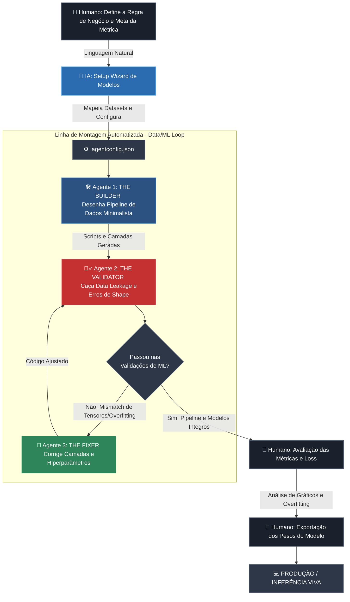

# 🧠 Agentic AI/ML Model Factory (UAH)

Este repositório contém o modelo arquitetural de **Fábrica de Modelos de IA e Ciência de Dados** projetado para desenvolvimento solo de alta performance auxiliado por Inteligência Artificial (ex: Claude Code, Cursor, Copilot).

O objetivo deste harness é desacoplar totalmente a **governança da IA de experimentação** (reprodutibilidade, controle de métricas, consumo de VRAM e integridade) do **algoritmo ou framework específico** (PyTorch, TensorFlow, Hugging Face, Scikit-Learn), garantindo uma esteira de pesquisa ágil e resiliente.

---

## 🏗️ Estrutura do Sistema

```text
.
├── .agent-harness/
│   ├── AGENTS_CORE.md         # Princípios Universais (Data Integrity, Otimização de Compute, Multi-Agente)
│   ├── SETUP_PROMPT.md        # Prompt inicial para ativação do Setup Wizard de ML
│   ├── mcp/
│   │   └── mcp-config.json    # Conexões MCP (Ex: Inspetores de tensores, monitores de GPU)
│   ├── memory/
│   │   └── ctx_memory.md      # Memória de hiperparâmetros, linhagem de dados e pesos
│   ├── changelog/
│   │   └── updates.md         # Changelog de modelos: data | versão | mudanças | métrica
│   ├── templates/
│   │   ├── seed_everything.py # Seed global única (random, numpy, torch, cudnn, workers)
│   │   └── check_leakage.py   # Falha se um id aparece em mais de um split
│   └── logs/
│       ├── mapping/           # Mapeamento de shapes de tensores e matrizes de confusão
│       └── archive/           # Histórico de perda (loss), métricas e falhas de treinamento
├── tests/                     # Testes dos utilitários do harness (pytest)
├── CLAUDE.md / AGENTS.md      # Ponteiros que fazem Claude Code / Cursor / Copilot carregarem o AGENTS_CORE.md
├── .agentconfig.json          # Metadados do modelo atual e comandos de execução do pipeline
├── .env.example               # Modelo de chaves de provedores e conexões de storage (S3/HuggingFace)
└── .gitignore                 # Filtro de segurança (chaves, datasets .csv/.pkl, pesos .pt/.safetensors, etc.)
```

> `CLAUDE.md` / `AGENTS.md` são necessários porque as ferramentas não leem `AGENTS_CORE.md` automaticamente.

---

## 🤖 O Protocolo Multi-Agente para Machine Learning

Toda interação realizada através deste harness faz a IA percorrer um ciclo de 3 papéis distintos, **registrando a evidência de cada um no log da execução** (um papel não registrado não foi executado), antes de salvar qualquer script:

1. **THE BUILDER (O Criador):** Desenha a arquitetura matemática minimalista, funções de transformação de dados (*features*) e loops de treinamento básico.
2. **THE VALIDATOR (O Validador):** Atua de forma adversarial. Audita os shapes das matrizes e caça ativamente problemas como *data leakage* (vazamento de dados entre treino/teste), falta de sementes globais (*random seeds*) ou loops pesados não-vetorizados.
3. **THE FIXER (O Reparador):** Intercepta os erros de dimensão e performance apontados pelo validador, aplicando correções cirúrgicas nas camadas da rede ou nos dataframes antes da validação final.

O desenvolvedor humano atua estritamente como **Human-in-the-Loop**, analisando as métricas finais (Acurácia, F1-Score, Curvas ROC), logs de perda e controlando a persistência e exportação dos pesos oficiais dos modelos.

---

## 🗺️ Fluxograma Operacional: Linha de Montagem de Modelos IA

Abaixo está o mapeamento visual de execução de tarefas focado em Ciência de Dados dentro deste ecossistema. O GitHub renderiza este gráfico automaticamente:



---

## 🚀 Como Utilizar no Dia a Dia

1. **Clone este modelo** (ou copie a pasta `.agent-harness`) para a raiz de qualquer novo projeto de inteligência artificial ou análise de dados.
2. Abra a pasta do projeto no seu **VS Code**.
3. Inicialize o seu agente de IA de preferência (abra o terminal do `claude code` ou o painel de chat do Cursor).
4. Abra o arquivo `.agent-harness/SETUP_PROMPT.md`, copie o seu conteúdo e envie no chat do agente para ativar o **Setup Wizard**.
5. Responda sequencialmente às perguntas da IA para configurar as diretivas matemáticas e experimentais do arquivo `.agentconfig.json`.
6. Comece a criar suas transformações de dados e arquiteturas de modelos enviando comandos diretos em linguagem natural.
